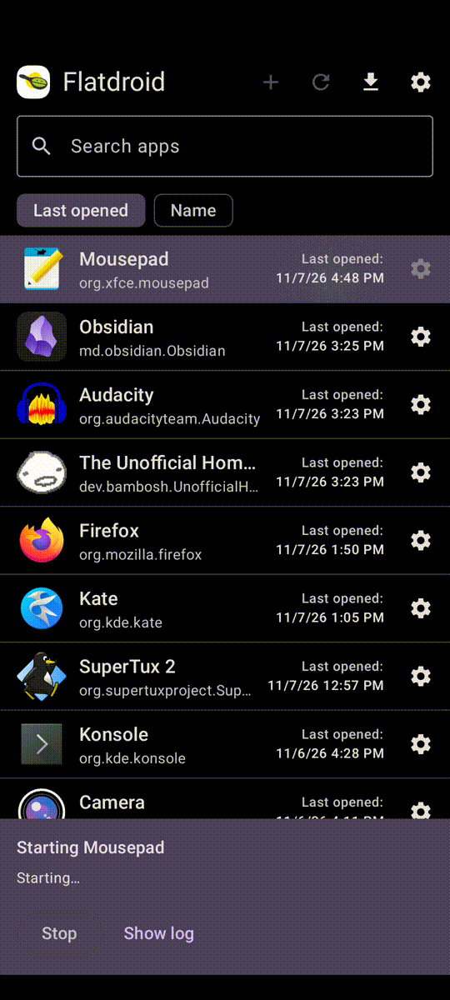
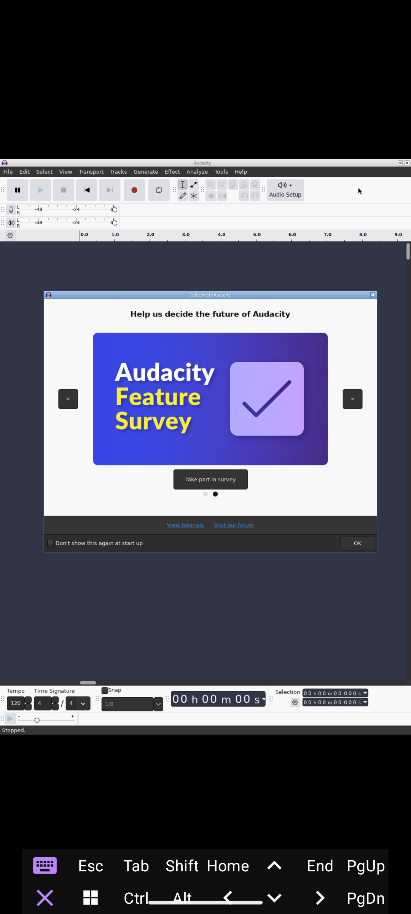
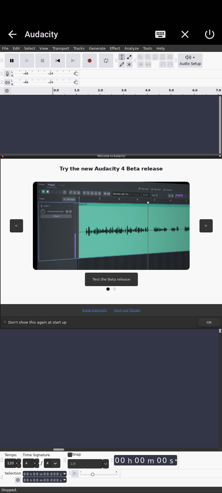

# Flatdroid


An Android based Flatpak runner which uses proot to provide the needed environment for Flatpaks to run.

## Contents

- [Overview](#overview)
- [Installation](#installation)
- [Screenshots](#screenshots)
- [Features](#features)
- [Building](#building)
- [Methodology](#methodology)
- [Security](#security)
- [Contributing](#contributing)
- [Acknowledgments](#acknowledgments)

## Overview

Flatdroid runs Linux desktop Flatpak apps from Flathub on Android phones, with no root. It sets up a small Alpine Linux environment inside the app using proot, and uses the `flatpak` CLI to download and update apps. It then launches each app with its own launcher, as Flatpak's normal sandbox can't run on Android (bwrap needs namespaces). Apps draw to a virtual Wayland/X11 display that you view with a VNC viewer.

The app creates and uses `Documents/Flatdroid` as its home directory.

Some apps (VLC/Firefox) may have issues that can be fixed by adding environment variables to their launch (turn on developer options in the settings to see them). These app fixes are found within `AppEnvironmentFixes.txt`.

This is an almost entirely vibe-coded app in order to train my agentic coding skills, this README however is written by a human who has verified everything stated herein (written doesn't mean Claude didn't tell me 500 times to include specific sections until I relented). Expect there to be issues, and me (the maintainer) to not have a complete knowledge of the codebase, but if you make a GitHub issue I will respond (given 2 weeks).

## Installation

Go to the releases tab, and for the most recent version download the release APK for the architecture your Android device runs (most likely Arm64).

Requirements:

- Version and Architecture: Android 7+ (minSdk 24), arm64-v8a (aka: aarch64) or x86_64.
- Internet: For initial setup, and Flatpak downloading.
- Storage Space: ~450 MB for initial required packages, and 0.4-1 GB per Flatpak runtime.

## Screenshots

<table><tr>
<td></td>
<td></td>
<td></td>
</tr></table>

## Features

Using Flatdroid, a user is able to install and launch Flatpaks apps on their Android device.

In order to install, at the home screen you hit the + icon on the topbar, and enter the Flatpak ID from [Flathub](https://flathub.org/) (Flathub is currently the only supported source), this will then begin installation and Flatdroid's own Flatpak setup, once it is done it will appear in your Flatpak list.

In order to launch and use a Flatpak, you tap the Flatpak within the home screen, and after it has been fully launched, you can hit "Open app" in order to view and interact with the Flatpak. Once you are finished with the Flatpak you can may exit through the Flatpak itself, or stop the Flatpak using Flatdroid.

In order to update, at the home screen you hit the refresh icon, this will first update all alpine packages, and then update all Flatpaks. Updating may take a while even after the download has been finished so please be patient.

In order to uninstall you go into the per-app settings, scroll to the bottom and select "Uninstall...".

### Settings Presets

Currently there are three security settings presets:

- Performant
    - Assumes all Flatpaks are trusted.
    - Sacrifices some security for performance.
        - Less CPU usage
        - More app functionality
        - More user friendly
- Default
    - Assumes some Flatpaks will try to be malicious.
    - Low cost hardening turned on.
        - Only a tiny bit more CPU usage compared to Performant
        - Some rarely used functionality is sacrificed for overall security
- Hardened
    - Assumes all Flatpaks know exactly how to exploit Flatdroid.
    - Security above all else.
        - Higher CPU usage
        - Longer launch/install/update times
        - Common functionality might be hampered
        - Limit shared files as much as possible

### Flatpak File Access

There are three home modes for apps:

- Shared Home
    - The home is found at `Documents/Flatdroid` in Android's shared storage.
    - On Android 11+ only files made by Flatdroid can be seen within this folder unless all file access is turned on.
        - To get around this you are able to "import" files into the shared home through Android's file picker, this is done through the download icon on the home screen.
    - Default home mode for Performant and Default.
    - Shared by all apps that use it.
- Private Home
    - Home is private to each individual app.
    - Default home mode for Hardened.
    - Good enough for most Flatpaks, just slightly worse UX.
    - Slightly faster reading/writing speeds than shared home files.
    - You are able to import and export specific files from each app's private home.
- Temporary Home
    - Private home except that it only exists per session and is deleted afterwards.
    - When a session ends you have the option to export what was made.

You can also optionally per-app mount all of Android's shared storage to `/sdcard` so you can access more than just `Documents/Flatdroid` (needs all files access).

### Embedded VNC Viewer

Instead of needing an external VNC viewer (you may still use one by going into settings), which comes with security issues, Flatdroid has it's own opinionated VNC viewer.

The reason this is safer is because the VNC connection isn't exposed to the rest of Android over localhost. Instead Flatdroid uses a local unix socket to transfer data directly to our embedded viewer. Due to Flatdroid controlling the viewer this also allows to implement more features, and optimizations that wouldn't be possible with an external viewer.

#### Controls

Topbar Buttons:

- The back button takes you back to the Flatpak list.
- Keyboard on tap brings up the keyboard, keyboard on hold brings up the extra keys by itself (or puts it down with a keyboard up).
- The X icon closes the currently focused window with an Alt+F4.
- The power icon turns off the app with a SIGINT (X icon leads to more graceful exits).

User Controls:

- Taps correlate to clicks, with double taps correlating to double clips.
- Dragging correlates to scrolling, with there being support for fling scrolling.
- Tapping, holding, and releasing without a drag correlates to a right click.
- Tapping, holding, and dragging correlates to a left click and drag.
- Using the Android back gesture or button correlates to Alt+left arrow (back on most browsers).
- You can zoom in and out with pinch.
- Two finger dragging allows you to pan a zoomed in screen, with there also being support for fling panning.
- Three finger tap opens up the keyboard.

### Export/Import Flatdroid Data

You are able to export/import:

- Flatdroid's global and per-app settings.
- All private homes.
- All Flatpak settings.
- Individual files to shared/private homes.
- Groups of files via zips to the shared home (Flatdroid unzips the files).

### flatdroid-sync

`tools/flatdroid-sync` is a shell utility that can transfer Flatpak settings between your PC and Flatdroid. It works by taking a Flatdroid compliant zip and pushing its Flatpak settings to your PC, or taking your PC's Flatpak settings and forming them into Flatdroid compliant zips.

Example Usage:

```
# Imports the individual app settings of the app
flatdroid-sync -i "UnofficialHomestuckCollection_settings.zip"

# Imports while taking a backup of app current settings
flatdroid-sync -b backup_hs.zip -i "UnofficialHomestuckCollection_settings.zip"

# Imports all app settings found within this zip that are tracked by flatpak on
# this system, whilst backing up the current settings
flatdroid-sync -b -i "Flatdroid Flatpak settings 2026-10-24 22-34.zip"

# Exports all Flatpak settings to the specified zip
flatdroid-sync -o all_settings.zip -x

# Exports the Flatpak settings for org.ex.app1 and com.ex.app2
flatdroid-sync -o app1_app2_settings.zip -x org.ex.app1 com.ex.app2

# Exports the Flatpak settings for only com.example.flat
flatdroid-sync -x com.example.flat
```

Dependencies: `zip`, `unzip`.

### Alpine Terminal

In case you want to modify the Alpine environment yourself, if this is to check issues, or otherwise you have been given shell access to the Alpine proot. This is not a terminal emulator like Termux, you have no consistent environment variables, or working directory, you fire one shell command at a time and your state resets each time.

## Building

- Requirements: Android SDK platform-tools, platforms;android-35, build-tools 35, NDK 30, JDK 21, CMake 3.22.1, make, git, curl, gawk, readelf.
- Clone the repository: `git clone https://github.com/Garaton/Flatdroid.git`.
- Build: In the base directory: `./gradlew assemble[architecture]["Release" or "Debug"]`.
  - ex: `./gradlew assembleArm64Debug`
  - Built APKs are found in `app/build/outputs/apk`.
- Architectures (only 64-bit supported): Arm64, X86_64, Universal.

Notes:

- The first build will need internet access to pull patched repositories.
- You need to sign release builds with your own key in order to install them.

## Methodology

Alpine rootfs and proot are used to install packages and run the Flatpak CLI for install, update, and uninstall. Flatpaks are launched outside of Alpine with a custom launcher under their own proot.

Flatpak Needs:

- When running: a runtime at /usr, app at /app, app data in ~/.var/app/\<APP-ID\>, and a .flatpak-info file.
- User namespaces (Android doesn't do namespaces).
- X11 or Wayland server.

Issues:

- bwrap and proot have compatibility issues so base `flatpak run` doesn't work (custom launcher used).

How it Works:

- proot is used to bind needed flatpak runtime data, and Documents/Flatdroid on flatpak launch.
- proot fakes success on namespaces, but Android doesn't have namespaces, which creates bwrap incompatibility.
- Flatpaks are launched through a custom launcher to get around bwrap and other issues.
- Xvnc + Openbox for X11, and wayvnc + labwc for Wayland, are used for display management.
- PulseAudio is used for audio/microphone.
- PipeWire, WirePlumber, xdg-desktop-portal, GStreamer, xdg-dbus-proxy are used for camera.
- Software only rendering.

## Security

Issues:

- Sandboxes are disabled in order for Flatpak to run.
    - This does not bypass Android's own sandbox.
    - Flatpaks are not isolated from each other.
    - Electron and WebKit run without their own sandboxes as well.
- If a Flatpak escapes proot, it will have access to everything Flatdroid has access to.

Hardening:

- Every Flatpak launch runs with a seccomp filter and non-dumpable proot. This makes Flatpaks from the fully extent of Flatdroid's permissions more difficult.
- Under normal conditions a Flatpak only has access to the files bound to it's proot.
- Different "Home Modes" to limit accessible files even more.
- Embedded VNC viewer to avoid putting the VNC instance anywhere on localhost.
- Per-Flatpak permissions, with the ability to also disable permissions.
- Optional per launch check to see if a Flatpak's files were modified by another process.
- Other miscellaneous low cost hardening.

Flatdroid does not collect, and does not care to collect any of your own personal data.

## Contributing

Currently Flatdroid is still under personal development, and is not in a state that I'm happy with to open for other people to build on. Therefore, until I reach that moment (UI, maybe other big features like embedded viewer/Flatpak browser) pull requests, and other contributions are closed. But, if you would like to submit issues I will be happy to review those.

## Acknowledgments

Flatdroid builds on and uses these projects:

- [PRoot](https://github.com/termux/proot): GPL-2.0-or-later, built from a pinned commit with small patches in `native/patches/`
- [talloc](https://talloc.samba.org/talloc/doc/html/index.html): LGPL-3.0-or-later
- [Alpine Linux](https://alpinelinux.org/): rootfs and packages
- [Flatpak](https://flatpak.org/): LGPL-2.1-or-later
- [Flathub](https://flathub.org/)
- [TigerVNC](https://tigervnc.org/) (Xvnc): GPL-2.0-or-later
- [Openbox](http://openbox.org/): GPL-2.0-or-later
- [PulseAudio](https://www.freedesktop.org/wiki/Software/PulseAudio/): LGPL-2.1-or-later
- [PipeWire](https://pipewire.org/): MIT
- [WirePlumber](https://pipewire.pages.freedesktop.org/wireplumber/): MIT
- [xdg-desktop-portal](https://github.com/flatpak/xdg-desktop-portal): LGPL-2.1-or-later
- [xdg-dbus-proxy](https://github.com/flatpak/xdg-dbus-proxy): LGPL-2.1-or-later
- [GStreamer](https://gstreamer.freedesktop.org/): LGPL-2.0-or-later

## License

Licensed under the GNU General Public License v3.0 or later (GPL-3.0-or-later). See LICENSE.

## DISCLAIMER

**Not affiliated with Flatpak, Flathub, or any Flatpak app developers.**

Ergo, don't report problems to Flatpak, Flathub, or app developers. Flatdroid runs apps in an unsupported environment, so expect issues. If you are unable to start an app, or it crashes unexpectedly, report the issue here.

